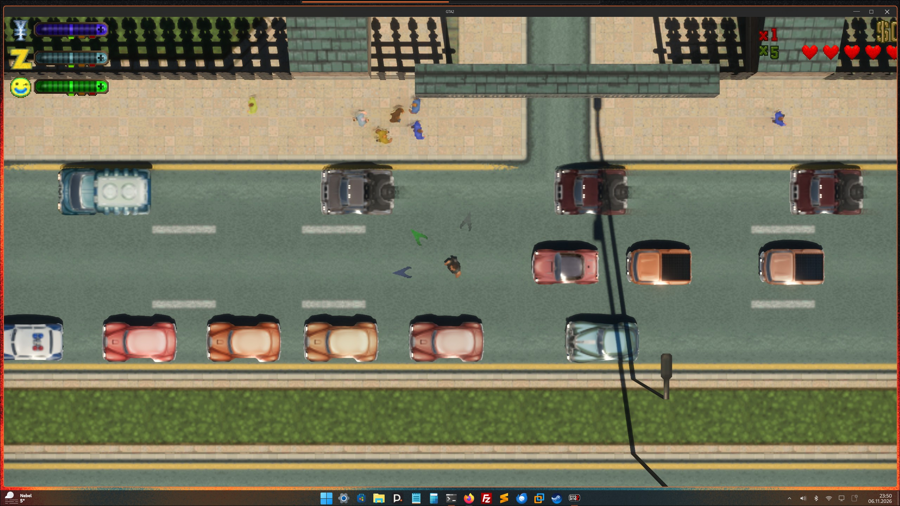
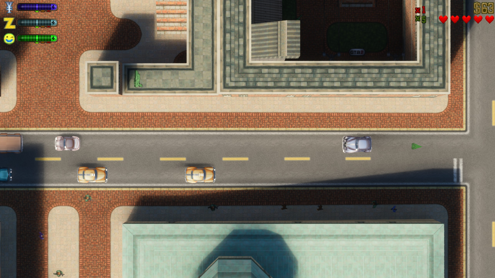

# GTA 2 + RTX Remix on Linux (Wine, Hyprland, NVIDIA)

How to run the **[GTA 2 RTX Remix mod](https://github.com/kirmm3la/gta2-rtx-remix-upgraded)**
(path-traced GTA 2, built on [gebdag/gta2-rtx-remix](https://github.com/gebdag/gta2-rtx-remix)) on Linux
with plain Wine. The mod officially targets Windows; this repo documents what it took to get a
working picture on **Hyprland (Wayland/Xwayland) + NVIDIA** and contains the launch scripts.

> **No game files here.** GTA 2, RTX Remix and the mod are not included and not redistributable by
> this repo. Get GTA 2 (v9.6) yourself, and the mod and Remix from their own pages (links below).

*Kurzfassung (DE):* GTA 2 mit RTX-Remix-Mod läuft unter Wine/Hyprland, wenn man (1) in der Mod
`own_window=1` setzt, (2) dem Spielfenster ständig den Fokus zurückgibt, (3) einen Monitor als
primär setzt und (4) VRR ausschaltet. Details unten.

## Screenshots

Running on the machine below (2560x1440, path traced, Wine on Hyprland):

## Tested setup

| | |
|---|---|
| OS | Arch-based (CachyOS), kernel 7.x |
| Compositor | Hyprland 0.56 (Lua config), Xwayland |
| GPU | NVIDIA RTX 4070 SUPER, proprietary driver |
| Wine | system `wine-11.21 (staging)` (GE-Proton10-28 behaved the same) |
| Remix | [Remix Plus v1.5.1 x86](https://github.com/RemixProjGroup/dxvk-remix/releases/tag/remix-plus-1.5.1) |
| Mod | `kirmm3la/gta2-rtx-remix-upgraded` v1.2 |
| Display | 3 monitors; game on the 2560x1440 one, others are rotated 1080x1920 / 1440x2560 |

## Install (outline)

1. Create a 32-bit-capable Wine prefix and install GTA 2 v9.6 into it.
2. Unpack the Remix x86 release and the mod into the GTA 2 folder (the mod README has the details).
3. Rename Remix's `d3d9.dll` to `d3d9_remix.dll`. The mod loads `d3d9_remix.dll` first, which keeps
   GTA 2's DirectDraw from grabbing the only allowed Remix device.
4. Apply the fixes below, then start with `scripts/start-gta2-rtx.sh`.

## The white screen, and what fixed it

The symptom: the game starts, music plays, the window stays **white**. There were three causes at once.

1. **`own_window=2` (the mod default).** The mod draws into its own topmost window because GTA 2's
   video device paints an empty frame over the game window. Hyprland ignores "topmost", the Remix
   bridge opens another 2560x1440 window, and you end up with 3 windows, one of them white.
   **Fix:** in `gta2dx9.ini` set `own_window=1` (child window) – one window, and the picture shows.
2. **GTA 2 freezes without keyboard focus.** The mod's window steals focus; GTA 2 gets
   `WM_KILLFOCUS` and stops drawing (log: `stall sampler: game thread idle ...`, hitches of 80+ s).
   That is why the menu is visible only for a moment.
   **Fix:** `scripts/gta2-focus-keeper.sh` gives focus back to the game window while it runs.
3. **Wrong primary monitor.** Xwayland reports no primary output, so Wine takes the first one
   (here a rotated 1080x1920 screen) and places windows partly off-screen (the log said
   `monitor 1080x1920`). **Fix:** `xrandr --output <your monitor> --primary` before starting.

Also:
- **Whole picture flickers, worse with more fps:** Hyprland **VRR** (`misc.vrr = 1`). The launch
  script switches it off while the game runs and restores it afterwards.
- Window rules (fullscreen on the right monitor, park the bridge window): `hyprland/gta2-rules.lua`.

## Things that did *not* matter

Raytracing on/off, exposure, the mod's time-of-day module, Wine virtual desktop
(`explorer /desktop=...`), GE-Proton vs system Wine. The `NGX`/`Reflex` errors in the Remix log are
normal under Wine (no DLSS).

## Graphics quality (work in progress)

- Remix picked the **Low** graphics preset automatically (it detected the GPU as "Turing").
  `rtx.graphicsPreset = 0` in `rtx.conf` selects **Ultra**.
- With Ultra, the TAA-U/FSR upscaler and FSR frame generation caused **ghosting**. Being tested:
  `DXVK_UPSCALER_TYPE=0` and `DXVK_FRAMEGEN_TYPE=0` (environment variables win over presets).
- Values (from the Remix Plus source): `rtx.upscalerType` 0 None, 1 DLSS, 2 NIS, 3 TAAU, 4 XeSS,
  5 FSR; `rtx.frameGenerationType` 0 None, 1 DLSS, 2 FSR.
- Above 30 fps the game runs faster (60 fps ≈ 2x speed): its logic uses fixed 33 ms steps.
- The main menu is a 640x480 bitmap scaled to 1440p, so it stays soft. That is normal.

## Files

- `scripts/start-gta2-rtx.sh` – launcher (env, primary monitor, focus keeper, VRR off/on). Configure
  with `WINEPREFIX`, `GAME_DIR`, `PRIMARY_MONITOR`.
- `scripts/gta2-focus-keeper.sh` – returns focus to the game window.
- `hyprland/gta2-rules.lua` – Hyprland (Lua) window rules.

## Notes and caveats

- Tested on one machine. Status: menu and gameplay work with path tracing; tuning is ongoing.
- On Hyprland with a Lua config, the old `hyprctl dispatch <name> <args>` form is rejected; the focus
  keeper takes a `HYPR_DISPATCH` command for that. Plain `hyprctl dispatch` is the default and is
  **untested** on my side (I used a small wrapper script).
- Not tested: AMD/Intel, other compositors, Proton instead of Wine for actual play.
- Issues and fixes welcome.

## Credits

Mod: [kirmm3la](https://github.com/kirmm3la/gta2-rtx-remix-upgraded) and
[gebdag](https://github.com/gebdag/gta2-rtx-remix). Runtime: NVIDIA RTX Remix and
[Remix Plus](https://github.com/RemixProjGroup/dxvk-remix). Worked out together with Claude Code.
GTA 2 © Rockstar Games.

## License

MIT for the scripts and docs in this repo (see `LICENSE`). Game, mod and Remix keep their own licenses.
